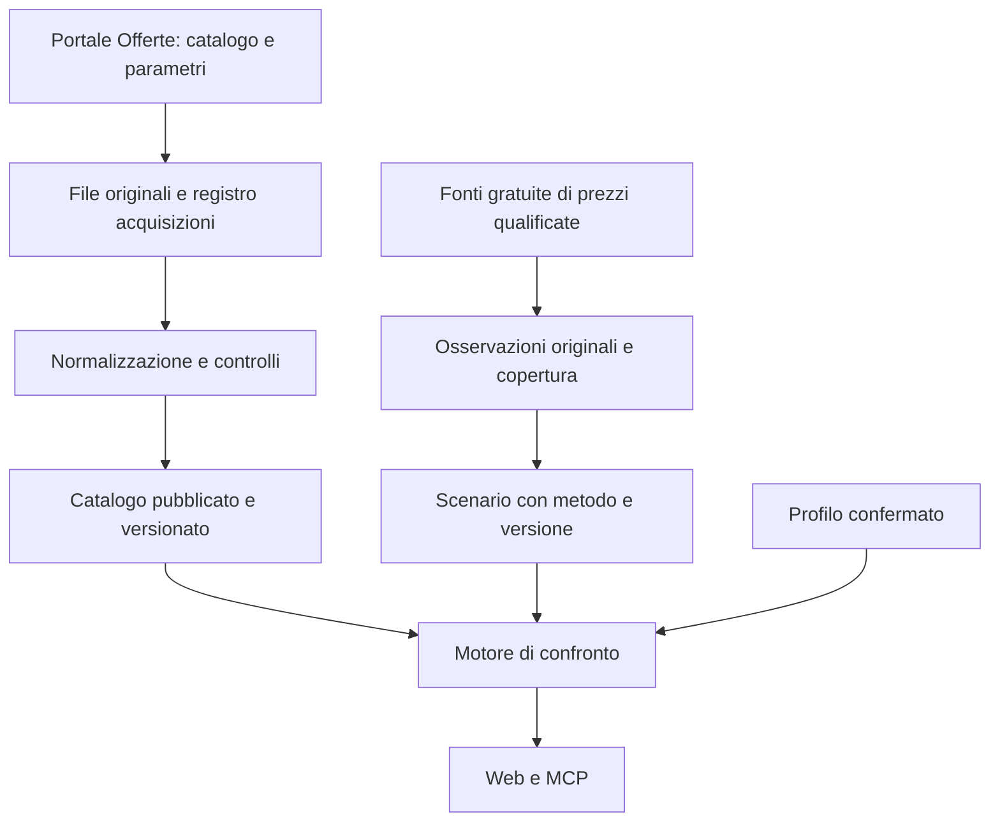

# Acquisizione quotidiana dei dati

Proposta tecnica del 26 ottobre 2026, da qualificare con una prima importazione reale. Ambito: clienti domestici, luce e gas, solo dati gratuiti. Applicazione e MCP gratuiti nella fase iniziale. Questo documento progetta il lavoro; non attesta un importatore operativo o autorizzazioni ulteriori delle fonti.

Il [design del percorso reale](./design-prodotto.md#primo-percorso-completo-con-dati-reali), confermato progressivamente il 27 ottobre, richiede caricamento/estrazione della bolletta, offerte fisse e variabili per entrambe le forniture, web e MCP già nella prima versione di verifica interna. Q26 limita il catalogo al mercato libero domestico nazionale, escludendo PLACET e pacchetti congiunti; Q29 restringe la prima fase alle offerte dichiarate simulabili dal Portale. Le altre offerte sono una possibile estensione della seconda fase. Le responsabilità tecniche separate qui descritte devono convergere in quella consegna: non implicano il rinvio di OCR o variabili a un traguardo successivo. Le restanti proposte di questo documento sono ancora da discutere.

## Priorità e rapporto con l'interfaccia

Lo [studio di fattibilità](./studio-fattibilita.md#sequenza-di-sviluppo-e-criteri-di-riuscita) prevedeva una prova dati e calcolo prima del comparatore reale. I ticket [#3](https://github.com/TommyBez/la-mia-bolletta/issues/3), [#4](https://github.com/TommyBez/la-mia-bolletta/issues/4) e [#5](https://github.com/TommyBez/la-mia-bolletta/issues/5) riguardano invece l'interfaccia con risposte sintetiche: non costituiscono il piano completo del prodotto.

Il design dell'importazione parte ora, mentre procede #3. Il prossimo lavoro sui dati è una prova completa di acquisizione, archivio, controlli e lettura del catalogo. Il collegamento della UI a risultati reali richiede anche il motore di ammissibilità e calcolo; un XML importato non contiene già il costo annuo. Le ulteriori attività di UI possono essere sviluppate con dati sintetici, ma non sostituiscono questi passaggi.

## Tre responsabilità distinte

| Modulo | Produce | Non decide |
| --- | --- | --- |
| Catalogo | Versioni delle offerte, parametri e riferimenti, con provenienza e copertura | Costo annuo e raccomandazione per l'utente |
| Osservazioni di prezzo | Valori originali, contratti, periodi di consegna, date e tipo di prezzo | Curva previsionale pronta o equivalenza con AU |
| Calcolo | Ammissibilità, stime e raccomandazione usando versioni esplicite | Download durante la richiesta dell'utente |

La costruzione di uno scenario di prezzo è un'elaborazione versionata distinta dall'acquisizione delle osservazioni. Conserva la selezione dei valori, conversioni, eventuali aggregazioni e metodo. Non si riempiono buchi temporali o fasce mancanti senza una regola esplicita e verificata.

**Priorità approvata Q42, 28 ottobre 2026:** il primo canale da implementare è il recupero dei coefficienti impliciti dalle simulazioni del Portale, [sperimentato su luce e gas](./recupero-indici-au-2026-10-28.md). L'acquisitore conserva sonde e condizioni ufficiali, input sintetici, dettagli economici, componenti sottratte, intervalli da arrotondamento e verifiche indipendenti; pubblica una versione utilizzabile soltanto dopo i controlli di coerenza e copertura. Prevedere sostituzione delle sonde scadute e rilevazione di cambiamenti del calcolatore. Aggiornamento degli indici mensile, distinto dal catalogo offerte quotidiano. Se questa strada non è implementabile in modo utilizzabile e operativo, il ripiego approvato è GME + nostra elaborazione Q39/Q41. Il metodo effettivo è esplicito nel manifesto e comune a web/MCP; **Q43/Q44, 29 ottobre:** lo script rimane separato dall'applicazione ed è lanciato manualmente una volta al mese per validare e importare nel DB uno snapshot versionato. Nessun recupero dal Portale durante il confronto utente. La finestra è allineata ai quattro trimestri dal trimestre corrente del Portale; il precedente mese aggiuntivo è eliminato.

## Fonti e copertura iniziale

**Vincolo Q28:** dati e condizioni delle offerte provengono esclusivamente dagli open data del Portale Offerte; interpretazione e calcolo seguono i tracciati e i metodi ufficiali. Non consultare siti, pagine o PDF dei fornitori, neppure per completare o correggere record ambigui. Il vincolo si applica anche alle ricerche manuali dell'agente e alle verifiche dei campioni. I collegamenti del venditore contenuti nell'export sono metadati, non fonti da acquisire.

Le osservazioni seguenti provengono dalle verifiche del 26 ottobre, integrate dall'[audit delle formule del 27 ottobre](./audit-formule-offerte-2026-10-27.md), non da una garanzia di continuità del servizio.

| Insieme | Evidenza disponibile | Trattamento proposto |
| --- | --- | --- |
| Mercato libero luce e gas | XML scaricati e analizzati; parametri ML in CSV | Primo percorso completo per entrambi i servizi |
| Offerte senza calcolo della spesa | Pagine ufficiali acquisite nella ricerca: 1.058 schede luce e 249 gas, tutte le categorie; canoni reali verificati. Nessun export strutturato separato individuato | Fuori dalla prima fase per Q29. Conservare la ricerca per una possibile estensione; nessun connettore HTML, acquisizione quotidiana o calcolo di queste schede richiesto per la prima consegna |
| PLACET luce e gas | Collegamenti CSV pubblicati; audit dei record ancora da completare | Esclusi dal primo traguardo per decisione Q26; non sono dipendenze obbligatorie dell'importazione iniziale |
| Indici storici | Esportati dal Portale con data diversa dalle offerte | Versioni indipendenti; non sostituiscono i forward |
| Territorio, imposte, profili gas e altre tabelle richieste dal calcolo | Requisiti individuati nelle regole; inventario delle fonti/versioni da completare | Matrice esplicita tra dati già negli export, riferimenti esterni e dati mancanti |
| Offerte dual fuel | Export distinto non analizzato | Fuori dal primo confronto indipendente luce/gas; le condizioni di adesione congiunta nelle altre offerte restano conservate |
| GME | Campione locale di 19 contratti e documentazione API | Dati di studio disponibili; raccolta sistematica/pubblicazione subordinate ai punti aperti dell'approfondimento |
| MiFIR EEX | File ed elenco programmatico già letti, condizioni accettate dall'utente | Alternativa gratuita da qualificare per copertura e costruzione dello scenario; non fallback automatico a GME |

Punti già emersi dai file reali:

- La [verifica conclusiva dei canoni](./verifica-calcolabilita-canoni-2026-10-27.md) ha recuperato accise e addizionali gas dal dettaglio pubblico “Imposte → Corrispettivi unitari” per Milano, con risultati verificati a 300, 350 e 1.600 Smc. Questi dati non sono nei CSV gas esaminati. È una fonte pubblica puntualmente acquisibile, non una tabella nazionale o un importatore già disponibili. La qualifica dell'allocazione IVA del canone resta distinta dall'acquisizione delle aliquote.

- I parametri ML esaminati hanno le colonne `nome_parametro`, `valore`, `descrizione`: 100 righe luce e 96 gas. Non hanno colonne strutturate per unità o intervallo di efficacia. Non dedurremo l'efficacia dalla sola data nel nome del file.
- PLACET pubblica parametri separati da quelli ML. Codici e significati vanno interpretati per famiglia e versione del tracciato.
- L'XML esaminato non fornisce un identificatore globale che garantisca una pubblicazione simultanea di tutti i file. La nostra versione del catalogo sarà un insieme verificato dall'applicazione, non una transazione garantita dal Portale.
- Il catalogo gas include sei offerte miste con semantica da qualificare. Il catalogo deve preservarle; Q27 non autorizza a rinviarle per la sola complessità o rarità. La possibilità di calcolare un record e la copertura necessaria a completare il primo percorso sono verifiche distinte.
- Gli XML includono rate costanti associate alle normali tariffe fisse/variabili. Lo zero nei campi tecnici del canone non descrive tutte le offerte pubblicate: alcune sono nella sezione ufficiale senza calcolo. I suoi testi e prezzi «a partire da» non vanno convertiti automaticamente in record pienamente calcolabili, né uniti agli XML tramite il solo nome. La [verifica del catalogo](./approfondimento-canone-catalogo-2026-10-27.md) documenta fonti e limiti; l'acquisizione HTML provata nella ricerca non è un connettore già implementato.
- I codici geografici devono restare stringhe: gli zeri iniziali sono significativi. Valori decimali, unità, campi assenti e zero devono restare distinguibili.

Riferimenti: [fonti e audit Portale](./studio-fattibilita.md#dati-verificati), [GME](./approfondimento-gme-2026-10-26.md), [MiFIR](./verifica-mifir-2026-10-26.md). La qualifica GME ancora aperta non blocca l'importazione del catalogo Portale. Nessuna fonte a pagamento viene attivata.

## Un aggiornamento, dall'inizio alla pubblicazione

1. **Scoperta.** Leggere la pagina ufficiale degli open data e selezionare i collegamenti effettivi per famiglia/fornitura. Registrare anche la pagina o il manifesto osservato. Non costruire un URL presumendo che esista il file di oggi.
2. **Acquisizione.** Scaricare i file necessari con timeout, limiti di dimensione e tentativi limitati. Usare richieste condizionali quando supportate. Conservare URL sorgente canonico e destinazione finale priva di query sensibili, checksum dei byte, dimensione, data di acquisizione e metadati HTTP; controllare che un HTTP 200 non sia una pagina di errore.
3. **Archivio.** Salvare gli originali immutabili prima della normalizzazione. Lo stesso contenuto può essere referenziato da più acquisizioni senza duplicarlo. La data della fonte e il momento in cui l'abbiamo controllata restano distinti, anche con HTTP 304.
4. **Normalizzazione.** Interpretare i file secondo la famiglia/versione del tracciato in un'area provvisoria. Conservare note e valori originali, riferimenti al file e al record. Non eseguire testo del venditore né seguire i suoi link durante l'importazione.
5. **Verifica.** Controllare integrità, identità, riferimenti, significato dei campi, unità, validità temporali, copertura richiesta e differenze rispetto al catalogo precedente. Produrre un rapporto leggibile con quantità e motivazioni, non soltanto un esito booleano.
6. **Pubblicazione.** Rendere leggibile una nuova versione solo con tutti i file obbligatori della copertura dichiarata e i controlli superati. La transazione finale cambia il riferimento al catalogo corrente; le richieste già aperte conservano la propria versione.
7. **Esito.** Registrare `published`, `unchanged`, `rejected` o `failed`. Un contenuto identico con lo stesso parser non crea nuove versioni delle offerte. Un nuovo parser può generare una nuova normalizzazione dagli stessi file, con propria versione.

Un file con la stessa data ma contenuto corretto dalla fonte è una nuova acquisizione e può generare nuove versioni. Un file riscaricato oggi ma identico non diventa automaticamente un'offerta aggiornata oggi.

### Compatibilità dei file

Il manifesto di pubblicazione elenca gli esatti file, le versioni dei parser e i riferimenti economici usati. La stessa data nei nomi non basta a provarne la compatibilità; date diverse non bastano a provarne l'incompatibilità, per esempio per indici mensili e offerte quotidiane.

La copertura richiesta è fissata da una policy versionata: la scomparsa di un collegamento nella pagina non riduce automaticamente i file obbligatori. La policy iniziale comprende le offerte dichiarate simulabili del mercato libero luce/gas e i relativi parametri; esclude PLACET secondo Q26 e le offerte senza simulazione secondo Q29. Per ogni insieme obbligatorio si registra una regola di selezione: famiglia, fornitura, periodo applicabile, dichiarazione ufficiale di simulabilità e dipendenze. Se il significato o l'efficacia di un parametro necessario non sono risolti, il dato può essere archiviato ma non dichiarato pronto per il calcolo. Non si combina automaticamente un nuovo catalogo con vecchi parametri per completare un download fallito.

La dichiarazione di simulabilità va interpretata attraverso la fonte e la codifica ufficiali applicabili, conservandone la provenienza; non coincide con la capacità attuale del nostro motore. Non dedurla da parole come Flat o rata, né promuovere una scheda non simulabile perché ne sappiamo calcolare un caso. Uno stato ufficiale non determinato richiede verifica prima dell'inclusione nel catalogo operativo. Se una versione futura del Portale dichiara simulabile un'offerta oggi esclusa, la sua nuova versione va valutata nel perimetro ordinario. Le pagine delle non simulabili non sono file obbligatori per pubblicare il catalogo della prima fase.

Il primo rilascio può avere cataloghi pubblicati separati per luce e gas: un guasto al gas non deve impedire l'aggiornamento luce. All'interno della singola fornitura, la copertura dichiarata del mercato libero e le sue dipendenze devono essere complete. Il confronto complessivo conserva entrambe le versioni e richiede periodi e scenari compatibili.

### Errori dell'insieme e limiti di una singola offerta

- Download mancante, file troncato, identità ambigua, duplicati conflittuali o struttura non interpretabile: respingere il candidato della fornitura interessata, conservando quello precedente.
- Formula o requisito riconosciuto ma non ancora supportato dal calcolo: conservare l'offerta e il motivo; renderla consultabile senza costo o posizione inventati. Distinguere questo caso da un record ambiguo o incompleto rispetto ai tracciati e metodi ufficiali: non completarlo consultando il fornitore.
- Campo economico nuovo: non ignorarlo. Se è possibile preservare e identificare con certezza il record, marcarlo come non supportato; se compromette l'interpretazione del tracciato, respingere l'insieme.
- Condizione solo testuale: conservarla con il contesto. L'analisi semantica successiva non è un requisito per scaricare il catalogo e non deve trasformare una parola chiave in un'esclusione automatica.
- Offerta assente da un export completo: segnare che non è più osservata nella copertura corrente, conservando lo storico. Non equivale a dire che i contratti già sottoscritti siano cessati.

Il controllo delle variazioni deve includere offerte totali, domestiche, supportate, non supportate e motivi. Le soglie si fissano con la prova iniziale e sono versionate: nessuna percentuale inventata autorizza silenziosamente una perdita di catalogo. Il primo catalogo richiede una revisione del rapporto perché non esiste ancora una base di confronto.

Per Q27 il rapporto deve distinguere anche famiglie e combinazioni delle formule, codici unici e P.IVA, presenza del campo ed effetto economico, all'interno del perimetro dichiarato simulabile di Q29. L'audit del 27 ottobre fornisce la prima base riproducibile, non frequenze permanenti. La comparsa di una nuova formula o una variazione rilevante della copertura richiede rivalutazione; un record non determinabile non è considerato poco conveniente. Conservare l'offerta simulabile senza prezzo inventato resta il comportamento corretto del catalogo, ma non basta a dichiarare completata una versione che omette formule frequenti o economicamente rilevanti del proprio perimetro. Le offerte ufficialmente non simulabili sono fuori perimetro, non errori di importazione o carenze di copertura della prima fase. Web e MCP dichiarano questa copertura senza promettere il confronto di tutte le offerte pubblicate.

## Modello minimo da conservare

| Entità | Informazioni essenziali |
| --- | --- |
| Esecuzione | Fonte/ambito, avvio e fine, esito, errori, tentativi, ultima fase completata |
| File sorgente | URL, hash dei byte, acquisizione, data dichiarata dalla fonte e relativa evidenza, metadati, percorso dell'originale |
| Versione dell'offerta | Identità della fonte/famiglia/fornitura/codice, contenuto normalizzato, hash semantico, versione parser, validità di adesione e condizioni, riferimenti agli originali |
| Parametri e riferimenti | Insieme/versione, valori e descrizioni originali, significato/unità/efficacia qualificati separatamente; nessuno zero per un valore mancante |
| Catalogo pubblicato | Ambito, manifesto completo, versioni offerte/parametri/riferimenti, parser, rapporto controlli, copertura, data pubblicazione |
| Osservazione di prezzo | Fonte, contratto/indice, valore e unità originali, natura del prezzo, periodo di consegna, data sessione/osservazione, acquisizione, riferimenti al file |
| Scenario di prezzo | Versioni delle osservazioni, metodo e conversioni, orizzonte e copertura, assunzioni e stato di qualificazione |

Separare il tempo di validità dichiarato dalla fonte dal tempo in cui l'applicazione ha conosciuto quel dato. Conservare le correzioni senza sovrascrivere il passato. L'archivio parte dalle acquisizioni effettive: non ricostruisce automaticamente contratti storici mai acquisiti.

Proposta infrastrutturale minima: un processo di importazione schedulato, Postgres per versioni/manifesti e storage a oggetti per originali. Non servono una coda distribuita o microservizi per i volumi osservati. L'hosting su Vercel e la possibilità di sostenere costi tecnici sono confermati in Q21; database, storage e budget preciso restano da definire. Il costo dei dati energetici deve restare zero. Non eliminare versioni necessarie a riprodurre un confronto conservato. Il catalogo pubblico non contiene bollette, profili personali o credenziali OCR; secondo Q25, le bollette della prima versione interna sono conservate separatamente, senza cancellazione automatica.

## Interface dei moduli

La UI e il client MCP non devono conoscere XML, CSV, URL dei download, tentativi o stato dei file provvisori. Il motore usa la stessa Interface di lettura per entrambi.

| Chiamata concettuale | Contratto |
| --- | --- |
| `refreshCatalog(scope)` | Operazione interna al processo schedulato/amministrativo; ritorna esito, rapporto e versione eventualmente pubblicata. Due esecuzioni concorrenti non possono pubblicare una versione vecchia sopra una più recente |
| `readCatalog(scope, version?)` | Risolve il catalogo pubblicato corrente oppure l'esatta versione richiesta; restituisce manifesto, copertura e dati immutabili, o assenza esplicita. Una versione storica richiesta e mancante non viene sostituita con quella corrente |
| `getCatalogStatus(scope)` | Copertura, ultima verifica riuscita, date delle fonti, ultima pubblicazione, eventuali errori e utilizzabilità per il calcolo; non espone cataloghi provvisori |

Queste sono operazioni del modulo, non una proposta di caricare tutte le offerte nel browser. Filtri e paginazione interni al motore devono rimanere ancorati alla versione scelta. `refreshCatalog` non è un tool MCP pubblico; il futuro `get_catalog_status` legge lo stesso stato della web app.

Il risultato di confronto conserva catalogo, regole, scenario e periodo di stima. Il manifesto del catalogo risolve anche le versioni dei parametri; `generatedAt` della risposta indica quando è stata calcolata, non quando la fonte ha aggiornato i dati. La risposta distingue sempre dati sintetici da dati reali.

**Precisazione Q32 dopo il giro 5:** il requisito dell’utente è calcolare le offerte dichiarate simulabili del perimetro. Conservare un record con un motivo di errore serve alla diagnosi, ma non autorizza una consegna con formule non implementate o una classifica parziale come soluzione approvata. Eventuali ambiguità dei dati ufficiali devono essere documentate e discusse; il comportamento del confronto in tali casi rimane da concordare.

### Precedenza degli intervalli: decisione approvata il 27 ottobre 2026

L'utente approva **il prezzo minimo in caso di conflitto**. Il motore condiviso da web e MCP applicherà questa regola fra intervalli della stessa componente, con unità e fascia coerenti, che risultino contemporaneamente applicabili al consumo e al periodo considerati:

1. Individuare gli intervalli specifici applicabili secondo limiti di consumo e validità temporale.
2. Usare l'intervallo senza limiti come default soltanto per le parti non coperte dagli specifici. Il default non compete sul prezzo con uno specifico applicabile.
3. Fra più intervalli applicabili in conflitto, selezionare il minimo del campo numerico `PREZZO`; non sommare i prezzi e non dipendere dall'ordine XML. La stessa regola vale per più default concorrenti quando si ricorre al fallback.

La selezione riguarda il prezzo della singola componente, non il costo annuo complessivo di offerte differenti. Non confrontare direttamente importi con unità diverse. Conservare il tipo fisso/variabile dell'intervallo selezionato e applicarne la formula: il minimo di `PREZZO` non equivale al minimo del prezzo completo comprensivo dell'indice. **Q37 approvata:** a parità del minimo numerico, se due intervalli applicabili hanno tipo fisso e variabile diverso, preferire il variabile e mantenerne l'indice. Il criterio è una decisione del nostro motore coerente con Senza Pensieri, non una precedenza interna del Portale dimostrata.

È una **decisione progettuale esplicita**, coerente con le [prove e la ricerca storica](./ricerca-storico-precedenza-2026-10-27.md), non una regola interna del Portale identificata univocamente. Il dubbio primo/minimo non blocca più la specifica. Originali, intervalli concorrenti e selezione effettuata devono restare tracciabili; la regola fa parte della versione delle regole di calcolo conservata nel confronto. Un conflitto risolto da questa regola non comporta scarto dell'offerta o rifiuto del catalogo.

Esempi da verificare nell'implementazione: intervalli concorrenti a 0,05 e 0,20 selezionano 0,05 in entrambi gli ordini; il default a zero non annulla uno specifico a 0,05; nella sovrapposizione di PREZZO NETTO ZERO GAS fra 0 e 0,05 viene selezionato 0; due intervalli a 0,08 con tipo diverso selezionano il variabile in entrambi gli ordini, senza duplicare il corrispettivo.

**Q38 approvata — scaglioni gas:** per ogni mese del periodo di stima, ripartire il consumo tramite il profilo pertinente; usare il cumulato dei mesi precedenti più metà del consumo mensile per individuare lo scaglione, poi applicare il prezzo selezionato all'intero consumo del mese. Il cumulato riparte dall'inizio del periodo di stima. La selezione fra intervalli segue minimo, fallback e pareggio descritti sopra. Il metodo deriva dalle prove predittive, è versionato e verificato mediante fixture; non viene presentato come formula esplicitamente pubblicata nelle guide. Questa regola riguarda gli scaglioni commerciali del gas: non sostituisce automaticamente la progressività delle imposte o delle componenti regolate.

**Q36 approvata — IVA:** applicare correttamente le formule fiscali ufficiali. Il modello sperimentale dell'[anomalia IVA](./reverse-engineering-iva-2026-10-27.md) resta una fixture di divergenza nota: il nostro motore non deve riprodurre l'accumulo ripetuto. Il controllo distingue componenti di vendita e IVA, e documenta la ragione di un totale diverso dal Portale. Un prezzo previsionale diverso resta una causa separata di scostamento.

## Esecuzione quotidiana e indisponibilità

La [verifica dei vincoli Vercel](./verifica-runtime-vercel-2026-10-27.md) documenta cron, timeout, upload e opzioni di ripresa. È ricerca sulle capacità della piattaforma, non una configurazione già attivata.

La frequenza richiesta è un controllo quotidiano; l'ora va scelta dopo aver osservato la pubblicazione effettiva. Usare il fuso `Europe/Rome`, recuperare un'esecuzione saltata e impedire sovrapposizioni tramite un lock con scadenza e verifica della sua validità al momento della pubblicazione. Un arresto a metà non deve lasciare un catalogo parziale leggibile.

Il controllo quotidiano del catalogo non determina la frequenza di ogni altra fonte. I pretrade MiFIR sono aggiornamenti incrementali disponibili per una finestra limitata: una loro acquisizione deve avere una frequenza e una verifica di completezza proprie. Conservare l’URL sorgente MFS, senza riutilizzare come riferimento stabile il redirect firmato temporaneo né registrarne query sensibili nei log; distinguere aggiornamenti di un solo lato, cancellazioni e prezzi mancanti. Questi requisiti riguardano il futuro adapter MiFIR, non il primo importatore Portale.

Retry limitati, attesa progressiva e rispetto di `Retry-After`; nessun ciclo aggressivo o aggiramento di un blocco del servizio. Per MiFIR questo è già rilevante: l'audit ha incontrato HTTP 429. Validare destinazioni ufficiali e redirect, disabilitare entità esterne XML e imporre limiti di decompressione/parsing.

Se l'importazione fallisce, il catalogo precedente resta consultabile con date e stato dell'aggiornamento. Per nuovi confronti serve una regola esplicita di utilizzabilità: controlli temporali dell'offerta, dati economici applicabili e freschezza della fonte. Conservare l'ultimo catalogo non significa poter raccomandare offerte scadute o garantire che siano ancora sottoscrivibili.

Prima del rilascio si devono fissare per fonte soglie di ritardo, comportamento della raccomandazione e avviso operativo, sulla base della continuità osservata. In assenza di una regola qualificata, il percorso resta di studio; non presentare la freschezza come validata. Il primo allarme operativo riguarda esecuzioni fallite o respinte; registrare separatamente fonti invariate, fonti vecchie e controlli mancati.

## Prova di accettazione

Verificare l'intero modulo attraverso refresh e lettura, usando file campione reali e varianti controllate. Per atomicità e concorrenza usare anche il database effettivo; un mock non dimostra il comportamento della transazione.

| Caso | Esito richiesto |
| --- | --- |
| Prima importazione luce/gas | Manifesti, conteggi e campioni confrontabili con gli originali; copertura mercato libero e esclusione PLACET esplicite |
| Stessi file due volte / HTTP 304 | Nuova verifica registrata, nessuna falsa nuova versione o nuova data della fonte |
| Correzione a parità di URL/data | Nuovo contenuto rilevato; versione precedente ancora riproducibile |
| File obbligatorio mancante o HTML invece di CSV | Nessuna pubblicazione parziale o rimozione fittizia delle offerte |
| Campo economico nuovo, unità ignota, duplicato conflittuale | Motivo visibile; nessun prezzo zero o record scartato in silenzio |
| Crash prima/durante la pubblicazione | Lettori vedono il precedente catalogo completo oppure il nuovo completo |
| Gas respinto, luce valida | Luce pubblicata; gas precedente ancora identificabile. Totale solo con versioni applicabili e compatibili, senza ignorare lo stato del gas |
| Due aggiornamenti fuori ordine | Il più vecchio non sostituisce il più recente; nessuna pubblicazione da un processo che ha perso il lock |
| Offerta scaduta o rimossa | Esclusa dalle nuove adesioni secondo le regole; storico ancora leggibile |
| Offerta dichiarata non simulabile, anche se un suo caso è ricostruibile | Fuori dal catalogo operativo e dal confronto della prima fase per Q29; non limita la copertura promessa delle simulabili |
| Offerta dichiarata simulabile con record ambiguo o formula non ancora supportata | Resta nel perimetro e nel rapporto di qualifica; limite esplicito, nessun prezzo inventato e nessuna riclassificazione automatica come non simulabile |
| Aggiornamento mentre un confronto è aperto | Dettagli e pagine successive usano ancora le versioni originali |
| Osservazioni prive di trimestre/fascia o data di rivalutazione | Copertura incompleta dichiarata; nessuno scenario completo inventato |

Una serie di acquisizioni nell'ambiente destinato all'esecuzione deve poi verificare accesso, orari, cambi dei collegamenti e ripartenze. Il successo di un singolo download non soddisfa questo criterio.

## Ordine del lavoro successivo

1. **Catalogo verificabile luce e gas:** inventario preciso dei file del mercato libero, originali e manifesti, normalizzazione, controlli, pubblicazione e lettura dello stato. La prima prova attraversa tutto il percorso con ML per entrambi, limitato alle offerte dichiarate simulabili secondo Q29; PLACET escluso secondo Q26.
2. **Confronto reale su profili campione:** inventario dei riferimenti mancanti, ammissibilità e calcolo deterministico; qualifica gratuita dei prezzi previsionali in parallelo. Una fonte non utilizzabile non blocca l'archivio offerte e non viene sostituita silenziosamente da un indice storico.
3. **Collegamento a web e MCP:** stessa Interface applicativa, versioni e stati di disponibilità. Prima di mostrare risparmi reali, validare i casi tariffari supportati e documentare gli scarti dal Portale. OCR e analisi delle note rimangono percorsi distinti.

Questa sequenza integra il piano UI, non cambia il contenuto approvato dei suoi tre ticket. Non sono ancora stati creati ticket di implementazione per l'ingestion. Le questioni da risolvere con la prova sono copertura e significato dei file, coerenza temporale, continuità delle fonti e disponibilità dei prezzi. Hosting Vercel e conservazione delle bollette senza cancellazione automatica sono già confermati in Q21/Q25. Restano da definire il comportamento sui dati in ritardo e, attraverso la qualifica tecnica, soglie per fonte, piano e budget operativo, database, storage e modalità di esecuzione.

## Q48 approvata — orchestrazione con Vercel Workflow

Valutazione del29ottobre2026, successivamente confermata dall’utente nella discussione tecnica. Q49 conferma Postgres su Neon e Blob privato. La proposta è Cron giornaliero → avvio rapido di un Workflow per fornitura → acquisizione originali inBlob → normalizzazione in staging → controlli → pubblicazione transazionale nelDB. Lo script dei coefficienti resta separato/manuale Q43; non viene aggiunto un avvio automatico mensile.

Cron decide quando avviare; Workflow conserva il progresso e coordina retry/ripresa dei passi. Le operazioni di acquisizione, parsing, validazione e pubblicazione restano moduli normali, invocati da step sottili e testabili senza il runtime Workflow. Lo stato operativo Workflow non sostituisce il catalogo/versioni nelDB o gli originali inBlob.

Passare tra step identificativi, riferimentiBlob, hash, cursori e conteggi, evitando XML o grandi array serializzati. Raggruppare i riferimenti territoriali/fiscali in batch con concorrenza limitata; ogni step deve rispettare il limite di una Function. Il Workflow complessivo non trasforma uno step in un processo senza limite.

Gestire i retry come esecuzioni potenzialmente ripetute: chiavi idempotenti e vincoli univoci nelDB, contenutiBlob con digest, staging non leggibile dal confronto, switch atomico del puntatore pubblicato e controllo della versione fonte contro completamenti fuori ordine. Riprova per timeout/429/errori transitori; dato semanticamente invalido o schema non supportato produce esito da esaminare, senza pubblicare o ritentare indefinitamente. Cron duplicati o avvii manuali non producono doppia pubblicazione.

Vantaggio rispetto a una sola Function Cron: ripresa osservabile per fasi e batch, utile soprattutto alla raccolta dei riferimenti comunali. Costo/complessità aggiuntivi: dipendenza dal runtime e dal suo modello di replay, eventi/stato persistito oltre a compute eQueues. Monitorarli secondoQ45, senza un budget monetario preventivo. La sola dimensione dei dueXML non dimostra necessità di Workflow; la raccomandazione dipende da resilienza, fasi riutilizzabili e lavoro a batch.

Fonti ufficiali correnti: [overview](https://vercel.com/docs/workflows), [step/workflow](https://workflow-sdk.dev/docs/foundations/workflows-and-steps), [idempotenza](https://workflow-sdk.dev/docs/foundations/idempotency), [limiti e pricing](https://vercel.com/docs/workflows/pricing). Versione SDK, compatibilità Next e configurazione verranno fissate con un test reale dopo l'accordo tecnico, non sono già implementate.

## Q50/Q51 — persistenza e rappresentazione confermate

Metadati e versioni relazionali, struttura economica normalizzata inJSONB con schema validato e versionato, originaliXML inBlob privato conhash eprovenienza. Parametri/riferimenti/scenari separati e versionati. Il parser conserva il significato dei dati della fonte, unità e codici; l'interpretazione rimane nei moduli economici condivisi.

Le componenti sono dati tipizzati, mai codice da eseguire. Prezzi e coefficienti inJSON usano rappresentazioni decimali esatte (per esempio stringhe decimali), senza conversione intermedia aNumber che perda precisione. Eventuali colonne numeriche persistenti usano tipi esatti. Le scelte di libreria e precisione interna devono rispettare le regole di arrotondamento qualificate.

## Verifica Q52 — identità e modifiche ammesse

Il [tracciato AUretailv5.0](https://siiportale.acquirenteunico.it/documents/11387888/11426817/Funzionamento+e+Specifiche+del+Processo+di+Trasmissione+Offerte+Mercato+Retail_v5.0.pdf/c7fb0256-ce8d-0977-3356-227cfaa91443?version=1.0&t=1765796222946&download=true), §TO2.0051 p45, identifica l'offerta conCOD_OFFERTA+PIVA_UTENTE. Per offerte attive consenteDATA_FINE,MODALITAattivazione,MOD_PAGAMENTO,URLOFFERTA eoffertecongiunte; per nonancoraattive tuttiiparametri; per scaduteDATA_INIZIO/DATA_FINE. La nota8 p22 riassume gli stessi stati ma ometteURLOFFERTA rispetto al paragrafo specifico p45: mantenere questa differenza documentale, senza aggiungere campi non autorizzati.

Identità commerciale e osservazione tecnica sono distinte. Q52 è stata confermata dall’utente nella formulazione rivista: una scheda logica per chiave ufficiale, storia delle variazioni ammesse e riferimenti degli snapshot, nessuna duplicazione economica giornaliera se invariata. Le date determinano sottoscrivibilità e riaperture, non sono da sole una chiave univoca. Una modifica inattesa alle condizioni economiche di un'offerta già attiva richiede qualifica, non viene accettata semplicemente creando una nuova versione interna. Prima dell'attivazione la fonte ammette correzioni più ampie sullo stesso codice: non perdere tale evidenza.
