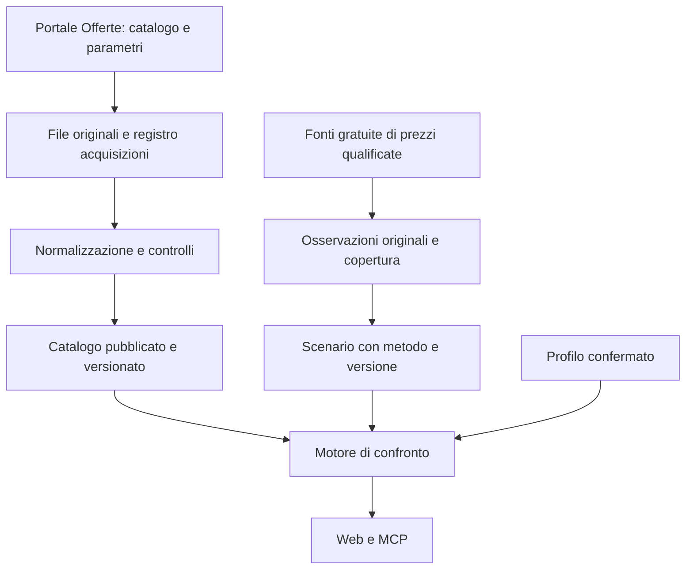

# Acquisizione quotidiana dei dati

Proposta tecnica del 26 ottobre 2026, da qualificare con una prima importazione reale. Ambito: clienti domestici, luce e gas, solo dati gratuiti. Applicazione e MCP gratuiti nella fase iniziale. Questo documento progetta il lavoro; non attesta un importatore operativo o autorizzazioni ulteriori delle fonti.

## Priorità e rapporto con l'interfaccia

Lo [studio di fattibilità](./studio-fattibilita.md#sequenza-di-sviluppo-e-criteri-di-riuscita) prevedeva una prova dati e calcolo prima del comparatore reale. I ticket [#3](https://github.com/TommyBez/la-mia-bolletta/issues/3), [#4](https://github.com/TommyBez/la-mia-bolletta/issues/4) e [#5](https://github.com/TommyBez/la-mia-bolletta/issues/5) riguardano invece l'interfaccia con risposte sintetiche: non costituiscono il piano completo del prodotto.

Il design dell'importazione parte ora, mentre procede #3. Il prossimo lavoro sui dati è una prova completa di acquisizione, archivio, controlli e lettura del catalogo. Il collegamento della UI a risultati reali richiede anche il motore di ammissibilità e calcolo; un XML importato non contiene già il costo annuo. Le ulteriori attività di UI possono essere sviluppate con dati sintetici, ma non sostituiscono questi passaggi.

## Tre responsabilità distinte

| Modulo | Produce | Non decide |
| --- | --- | --- |
| Catalogo | Versioni delle offerte, parametri e riferimenti, con provenienza e copertura | Costo annuo e raccomandazione per l'utente |
| Osservazioni di prezzo | Valori originali, contratti, periodi di consegna, date e tipo di prezzo | Curva previsionale pronta o equivalenza con AU |
| Calcolo | Ammissibilità, stime e raccomandazione usando versioni esplicite | Download durante la richiesta dell'utente |

La costruzione di uno scenario di prezzo è un'elaborazione versionata distinta dall'acquisizione delle osservazioni. Conserva la selezione dei valori, conversioni, eventuali aggregazioni e metodo. Non si riempiono buchi temporali o fasce mancanti senza una regola esplicita e verificata.

## Fonti e copertura iniziale

Le osservazioni seguenti provengono dalle verifiche del 26 ottobre, non da una garanzia di continuità del servizio.

| Insieme | Evidenza disponibile | Trattamento proposto |
| --- | --- | --- |
| Mercato libero luce e gas | XML scaricati e analizzati; parametri ML in CSV | Primo percorso completo per entrambi i servizi |
| PLACET luce e gas | Collegamenti CSV pubblicati; audit dei record ancora da completare | Stessa prima fase dati, con parser e parametri propri; supporto dichiarato soltanto dopo verifica |
| Indici storici | Esportati dal Portale con data diversa dalle offerte | Versioni indipendenti; non sostituiscono i forward |
| Territorio, imposte, profili gas e altre tabelle richieste dal calcolo | Requisiti individuati nelle regole; inventario delle fonti/versioni da completare | Matrice esplicita tra dati già negli export, riferimenti esterni e dati mancanti |
| Offerte dual fuel | Export distinto non analizzato | Fuori dal primo confronto indipendente luce/gas; le condizioni di adesione congiunta nelle altre offerte restano conservate |
| GME | Campione locale di 19 contratti e documentazione API | Dati di studio disponibili; raccolta sistematica/pubblicazione subordinate ai punti aperti dell'approfondimento |
| MiFIR EEX | File ed elenco programmatico già letti, condizioni accettate dall'utente | Alternativa gratuita da qualificare per copertura e costruzione dello scenario; non fallback automatico a GME |

Punti già emersi dai file reali:

- I parametri ML esaminati hanno le colonne `nome_parametro`, `valore`, `descrizione`: 100 righe luce e 96 gas. Non hanno colonne strutturate per unità o intervallo di efficacia. Non dedurremo l'efficacia dalla sola data nel nome del file.
- PLACET pubblica parametri separati da quelli ML. Codici e significati vanno interpretati per famiglia e versione del tracciato.
- L'XML esaminato non fornisce un identificatore globale che garantisca una pubblicazione simultanea di tutti i file. La nostra versione del catalogo sarà un insieme verificato dall'applicazione, non una transazione garantita dal Portale.
- Il campione gas include anche offerte miste. Il catalogo deve preservarle anche quando il motore iniziale non ne supporta il calcolo.
- I codici geografici devono restare stringhe: gli zeri iniziali sono significativi. Valori decimali, unità, campi assenti e zero devono restare distinguibili.

Riferimenti: [fonti e audit Portale](./studio-fattibilita.md#dati-verificati), [GME](./approfondimento-gme-2026-10-26.md), [MiFIR](./verifica-mifir-2026-10-26.md). La qualifica GME ancora aperta non blocca l'importazione del catalogo Portale. Nessuna fonte a pagamento viene attivata.

## Un aggiornamento, dall'inizio alla pubblicazione

1. **Scoperta.** Leggere la pagina ufficiale degli open data e selezionare i collegamenti effettivi per famiglia/fornitura. Registrare anche la pagina o il manifesto osservato. Non costruire un URL presumendo che esista il file di oggi.
2. **Acquisizione.** Scaricare i file necessari con timeout, limiti di dimensione e tentativi limitati. Usare richieste condizionali quando supportate. Conservare URL sorgente canonico e destinazione finale priva di query sensibili, checksum dei byte, dimensione, data di acquisizione e metadati HTTP; controllare che un HTTP 200 non sia una pagina di errore.
3. **Archivio.** Salvare gli originali immutabili prima della normalizzazione. Lo stesso contenuto può essere referenziato da più acquisizioni senza duplicarlo. La data della fonte e il momento in cui l'abbiamo controllata restano distinti, anche con HTTP 304.
4. **Normalizzazione.** Interpretare i file secondo la famiglia/versione del tracciato in un'area provvisoria. Conservare note e valori originali, riferimenti al file e al record. Non eseguire testo del venditore né seguire i suoi link durante l'importazione.
5. **Verifica.** Controllare integrità, identità, riferimenti, significato dei campi, unità, validità temporali, copertura richiesta e differenze rispetto al catalogo precedente. Produrre un rapporto leggibile con quantità e motivazioni, non soltanto un esito booleano.
6. **Pubblicazione.** Rendere leggibile una nuova versione solo con tutti i file obbligatori della copertura dichiarata e i controlli superati. La transazione finale cambia il riferimento al catalogo corrente; le richieste già aperte conservano la propria versione.
7. **Esito.** Registrare `published`, `unchanged`, `rejected` o `failed`. Un contenuto identico con lo stesso parser non crea nuove versioni delle offerte. Un nuovo parser può generare una nuova normalizzazione dagli stessi file, con propria versione.

Un file con la stessa data ma contenuto corretto dalla fonte è una nuova acquisizione e può generare nuove versioni. Un file riscaricato oggi ma identico non diventa automaticamente un'offerta aggiornata oggi.

### Compatibilità dei file

Il manifesto di pubblicazione elenca gli esatti file, le versioni dei parser e i riferimenti economici usati. La stessa data nei nomi non basta a provarne la compatibilità; date diverse non bastano a provarne l'incompatibilità, per esempio per indici mensili e offerte quotidiane.

La copertura richiesta è fissata da una policy versionata: la scomparsa di un collegamento nella pagina non riduce automaticamente i file obbligatori. Per ogni insieme obbligatorio si registra una regola di selezione: famiglia, fornitura, periodo applicabile e dipendenze. Se il significato o l'efficacia di un parametro necessario non sono risolti, il dato può essere archiviato ma non dichiarato pronto per il calcolo. Non si combina automaticamente un nuovo catalogo con vecchi parametri per completare un download fallito.

Il primo rilascio può avere cataloghi pubblicati separati per luce e gas: un guasto al gas non deve impedire l'aggiornamento luce. All'interno della singola fornitura, la copertura dichiarata ML/PLACET e le sue dipendenze devono essere complete. Il confronto complessivo conserva entrambe le versioni e richiede periodi e scenari compatibili.

### Errori dell'insieme e limiti di una singola offerta

- Download mancante, file troncato, identità ambigua, duplicati conflittuali o struttura non interpretabile: respingere il candidato della fornitura interessata, conservando quello precedente.
- Formula o requisito riconosciuto ma non ancora supportato dal calcolo: conservare l'offerta e il motivo; renderla consultabile senza costo o posizione inventati.
- Campo economico nuovo: non ignorarlo. Se è possibile preservare e identificare con certezza il record, marcarlo come non supportato; se compromette l'interpretazione del tracciato, respingere l'insieme.
- Condizione solo testuale: conservarla con il contesto. L'analisi semantica successiva non è un requisito per scaricare il catalogo e non deve trasformare una parola chiave in un'esclusione automatica.
- Offerta assente da un export completo: segnare che non è più osservata nella copertura corrente, conservando lo storico. Non equivale a dire che i contratti già sottoscritti siano cessati.

Il controllo delle variazioni deve includere offerte totali, domestiche, supportate, non supportate e motivi. Le soglie si fissano con la prova iniziale e sono versionate: nessuna percentuale inventata autorizza silenziosamente una perdita di catalogo. Il primo catalogo richiede una revisione del rapporto perché non esiste ancora una base di confronto.

## Modello minimo da conservare

| Entità | Informazioni essenziali |
| --- | --- |
| Esecuzione | Fonte/ambito, avvio e fine, esito, errori, tentativi, ultima fase completata |
| File sorgente | URL, hash dei byte, acquisizione, data dichiarata dalla fonte e relativa evidenza, metadati, percorso dell'originale |
| Versione dell'offerta | Identità della fonte/famiglia/fornitura/codice, contenuto normalizzato, hash semantico, versione parser, validità di adesione e condizioni, riferimenti agli originali |
| Parametri e riferimenti | Insieme/versione, valori e descrizioni originali, significato/unità/efficacia qualificati separatamente; nessuno zero per un valore mancante |
| Catalogo pubblicato | Ambito, manifesto completo, versioni offerte/parametri/riferimenti, parser, rapporto controlli, copertura, data pubblicazione |
| Osservazione di prezzo | Fonte, contratto/indice, valore e unità originali, natura del prezzo, periodo di consegna, data sessione/osservazione, acquisizione, riferimenti al file |
| Scenario di prezzo | Versioni delle osservazioni, metodo e conversioni, orizzonte e copertura, assunzioni e stato di qualificazione |

Separare il tempo di validità dichiarato dalla fonte dal tempo in cui l'applicazione ha conosciuto quel dato. Conservare le correzioni senza sovrascrivere il passato. L'archivio parte dalle acquisizioni effettive: non ricostruisce automaticamente contratti storici mai acquisiti.

Proposta infrastrutturale minima: un processo di importazione schedulato, Postgres per versioni/manifesti e storage a oggetti per originali. Non servono una coda distribuita o microservizi per i volumi osservati. Provider, budget infrastrutturale e retention operativa restano da scegliere prima del rilascio; il vincolo certo è costo zero per i dati. Non eliminare versioni necessarie a riprodurre un confronto conservato. Il catalogo pubblico non contiene bollette, profili personali o credenziali OCR.

## Interface dei moduli

La UI e il client MCP non devono conoscere XML, CSV, URL dei download, tentativi o stato dei file provvisori. Il motore usa la stessa Interface di lettura per entrambi.

| Chiamata concettuale | Contratto |
| --- | --- |
| `refreshCatalog(scope)` | Operazione interna al processo schedulato/amministrativo; ritorna esito, rapporto e versione eventualmente pubblicata. Due esecuzioni concorrenti non possono pubblicare una versione vecchia sopra una più recente |
| `readCatalog(scope, version?)` | Risolve il catalogo pubblicato corrente oppure l'esatta versione richiesta; restituisce manifesto, copertura e dati immutabili, o assenza esplicita. Una versione storica richiesta e mancante non viene sostituita con quella corrente |
| `getCatalogStatus(scope)` | Copertura, ultima verifica riuscita, date delle fonti, ultima pubblicazione, eventuali errori e utilizzabilità per il calcolo; non espone cataloghi provvisori |

Queste sono operazioni del modulo, non una proposta di caricare tutte le offerte nel browser. Filtri e paginazione interni al motore devono rimanere ancorati alla versione scelta. `refreshCatalog` non è un tool MCP pubblico; il futuro `get_catalog_status` legge lo stesso stato della web app.

Il risultato di confronto conserva catalogo, regole, scenario e periodo di stima. Il manifesto del catalogo risolve anche le versioni dei parametri; `generatedAt` della risposta indica quando è stata calcolata, non quando la fonte ha aggiornato i dati. La risposta distingue sempre dati sintetici da dati reali.

## Esecuzione quotidiana e indisponibilità

La frequenza richiesta è un controllo quotidiano; l'ora va scelta dopo aver osservato la pubblicazione effettiva. Usare il fuso `Europe/Rome`, recuperare un'esecuzione saltata e impedire sovrapposizioni tramite un lock con scadenza e verifica della sua validità al momento della pubblicazione. Un arresto a metà non deve lasciare un catalogo parziale leggibile.

Il controllo quotidiano del catalogo non determina la frequenza di ogni altra fonte. I pretrade MiFIR sono aggiornamenti incrementali disponibili per una finestra limitata: una loro acquisizione deve avere una frequenza e una verifica di completezza proprie. Conservare l’URL sorgente MFS, senza riutilizzare come riferimento stabile il redirect firmato temporaneo né registrarne query sensibili nei log; distinguere aggiornamenti di un solo lato, cancellazioni e prezzi mancanti. Questi requisiti riguardano il futuro adapter MiFIR, non il primo importatore Portale.

Retry limitati, attesa progressiva e rispetto di `Retry-After`; nessun ciclo aggressivo o aggiramento di un blocco del servizio. Per MiFIR questo è già rilevante: l'audit ha incontrato HTTP 429. Validare destinazioni ufficiali e redirect, disabilitare entità esterne XML e imporre limiti di decompressione/parsing.

Se l'importazione fallisce, il catalogo precedente resta consultabile con date e stato dell'aggiornamento. Per nuovi confronti serve una regola esplicita di utilizzabilità: controlli temporali dell'offerta, dati economici applicabili e freschezza della fonte. Conservare l'ultimo catalogo non significa poter raccomandare offerte scadute o garantire che siano ancora sottoscrivibili.

Prima del rilascio si devono fissare per fonte soglie di ritardo, comportamento della raccomandazione e avviso operativo, sulla base della continuità osservata. In assenza di una regola qualificata, il percorso resta di studio; non presentare la freschezza come validata. Il primo allarme operativo riguarda esecuzioni fallite o respinte; registrare separatamente fonti invariate, fonti vecchie e controlli mancati.

## Prova di accettazione

Verificare l'intero modulo attraverso refresh e lettura, usando file campione reali e varianti controllate. Per atomicità e concorrenza usare anche il database effettivo; un mock non dimostra il comportamento della transazione.

| Caso | Esito richiesto |
| --- | --- |
| Prima importazione luce/gas | Manifesti, conteggi e campioni confrontabili con gli originali; stato della copertura ML/PLACET esplicito |
| Stessi file due volte / HTTP 304 | Nuova verifica registrata, nessuna falsa nuova versione o nuova data della fonte |
| Correzione a parità di URL/data | Nuovo contenuto rilevato; versione precedente ancora riproducibile |
| File obbligatorio mancante o HTML invece di CSV | Nessuna pubblicazione parziale o rimozione fittizia delle offerte |
| Campo economico nuovo, unità ignota, duplicato conflittuale | Motivo visibile; nessun prezzo zero o record scartato in silenzio |
| Crash prima/durante la pubblicazione | Lettori vedono il precedente catalogo completo oppure il nuovo completo |
| Gas respinto, luce valida | Luce pubblicata; gas precedente ancora identificabile. Totale solo con versioni applicabili e compatibili, senza ignorare lo stato del gas |
| Due aggiornamenti fuori ordine | Il più vecchio non sostituisce il più recente; nessuna pubblicazione da un processo che ha perso il lock |
| Offerta scaduta o rimossa | Esclusa dalle nuove adesioni secondo le regole; storico ancora leggibile |
| Aggiornamento mentre un confronto è aperto | Dettagli e pagine successive usano ancora le versioni originali |
| Osservazioni prive di trimestre/fascia o data di rivalutazione | Copertura incompleta dichiarata; nessuno scenario completo inventato |

Una serie di acquisizioni nell'ambiente destinato all'esecuzione deve poi verificare accesso, orari, cambi dei collegamenti e ripartenze. Il successo di un singolo download non soddisfa questo criterio.

## Ordine del lavoro successivo

1. **Catalogo verificabile luce e gas:** inventario preciso di tutti i file, audit PLACET, originali e manifesti, normalizzazione, controlli, pubblicazione e lettura dello stato. La prima prova attraversa tutto il percorso con ML per entrambi; si completa la copertura PLACET prima di dichiararla disponibile.
2. **Confronto reale su profili campione:** inventario dei riferimenti mancanti, ammissibilità e calcolo deterministico; qualifica gratuita dei prezzi previsionali in parallelo. Una fonte non utilizzabile non blocca l'archivio offerte e non viene sostituita silenziosamente da un indice storico.
3. **Collegamento a web e MCP:** stessa Interface applicativa, versioni e stati di disponibilità. Prima di mostrare risparmi reali, validare i casi tariffari supportati e documentare gli scarti dal Portale. OCR e analisi delle note rimangono percorsi distinti.

Questa sequenza integra il piano UI, non cambia il contenuto approvato dei suoi tre ticket. Non sono ancora stati creati ticket di implementazione per l'ingestion. Le questioni da risolvere con la prova sono copertura e significato dei file, coerenza temporale, continuità delle fonti e disponibilità dei prezzi; le scelte operative residue sono hosting, retention e comportamento sui dati in ritardo.
