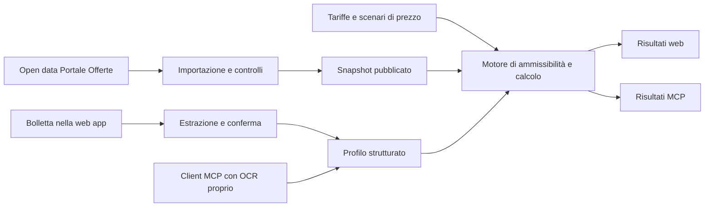

# Studio di fattibilità per La mia bolletta

Valutazione al 26 ottobre 2026. Ambito confermato: clienti domestici, luce e gas. Requisiti: acquisizione quotidiana dal Portale Offerte, confronto personalizzato, lettura della bolletta e accesso MCP alle medesime funzioni, con OCR a carico del client MCP. Rilevamento delle condizioni problematiche nelle note in una fase successiva.

Aggiornamento del perimetro del 27 ottobre: Q29 limita la prima fase alle offerte dichiarate simulabili dal Portale, nell'universo del mercato libero domestico definito da Q26. Le offerte senza simulazione restano una possibile estensione della seconda fase; gli approfondimenti già svolti vengono conservati. Decisioni correnti nel [design del prodotto](./design-prodotto.md).

Vincolo confermato dall'utente: **solo dati gratuiti**. Abbonamenti a dati e licenze a pagamento sono esclusi dalle soluzioni proposte.

Modello iniziale confermato dall'utente: **applicazione totalmente gratuita**, almeno nella fase iniziale. La verifica delle condizioni dei dati assume questo modello; eventuali cambiamenti futuri richiederanno una nuova valutazione delle condizioni applicabili.

Il progetto è tecnicamente fattibile. Il catalogo pubblico è scaricabile e contiene condizioni economiche strutturate, ma richiede un motore di calcolo proprio. La principale dipendenza da risolvere riguarda le quotazioni forward: il Portale le usa per le stime delle offerte variabili e le esclude dagli open data. La qualità del prodotto dipenderà soprattutto dalla correttezza del confronto, dalla gestione dei requisiti di accesso e dalla chiarezza delle assunzioni.

## Dati verificati

La [pagina ufficiale open data](https://www.ilportaleofferte.it/portaleOfferte/it/open-data.page) pubblica offerte PLACET in CSV, offerte del mercato libero luce, gas e dual fuel in XML, parametri economici in CSV e prezzi storici di indici pubblici. Il 26 ottobre 2026 i collegamenti alle offerte e ai parametri riportavano la data del giorno; gli indici storici riportavano il 7 ottobre. La pagina esclude esplicitamente i forward dagli open data.

Il download diretto degli XML e dei parametri luce e gas è riuscito. L'audit dei due XML del mercato libero ha prodotto questi conteggi:

| Export | Dimensione | Record e codici unici | Domestici | Tipologie domestiche |
| --- | ---: | ---: | ---: | --- |
| [Luce del 26 ottobre](https://www.ilportaleofferte.it/portaleOfferte/resources/opendata/csv/offerteML/2026_10/PO_Offerte_E_MLIBERO_20261026.xml) | 21,15 MB | 3.657 | 1.989 | 492 fissi, 1.497 variabili |
| [Gas del 26 ottobre](https://www.ilportaleofferte.it/portaleOfferte/resources/opendata/csv/offerteML/2026_10/PO_Offerte_G_MLIBERO_20261026.xml) | 15,04 MB | 2.850 | 1.623 | 307 fissi, 1.310 variabili, 6 misti |

Sono conteggi degli export esaminati: non misurano tutte le offerte esistenti sul mercato e non includono i file PLACET o dual fuel, non analizzati in questo audit. Il volume dei due XML consente un'importazione periodica ordinaria, senza un'infrastruttura distribuita complessa.

Gli XML contengono identificativi, validità, territorio, soglie di consumo e potenza, pagamenti, componenti economiche, indici, sconti, condizioni testuali, flag e collegamenti. Non contengono una spesa annua già calcolata. I [parametri luce](https://www.ilportaleofferte.it/portaleOfferte/resources/opendata/csv/parametriML/2026_10/PO_Parametri_Mercato_Libero_E_20261026.csv) e i [parametri gas](https://www.ilportaleofferte.it/portaleOfferte/resources/opendata/csv/parametriML/2026_10/PO_Parametri_Mercato_Libero_G_20261026.csv) forniscono ulteriori valori per il calcolo.

Le [informazioni legali del Portale](https://www.ilportaleofferte.it/portaleOfferte/it/informazioni-legali.page) dichiarano libero l'uso degli open data e richiedono di menzionare la fonte. Questo non autorizza automaticamente il riuso commerciale degli altri contenuti o dei marchi. Nell'applicazione va indicato «Fonte: Portale Offerte», con data dei dati e collegamento alla fonte; il calcolo dell'app va identificato come proprio.

La consultazione tramite servizi di ricerca ha incontrato risposte 403, mentre il download diretto è riuscito. Prima del rilascio occorre verificare il download dall'ambiente effettivo di esecuzione. Un singolo download riuscito non prova continuità, orario di pubblicazione o disponibilità garantita.

## Motore di confronto

Le [regole ufficiali attualmente collegate dal Portale](https://www.ilportaleofferte.it/portaleOfferte/resources/cms/documents/6bc502553cb0ea45958840b2de20078d.pdf) sono la versione 4.2 del 5 ottobre 2026. Comprendono offerte fisse, variabili, miste, onnicomprensive e a canone. Il calcolo include componenti commerciali, rete, oneri e imposte secondo la struttura dell'offerta; aggiungerle indistintamente causerebbe doppi conteggi. La stima delle variabili utilizza quattro trimestri a partire dall'inizio del trimestre corrente. I profili gas sono anch'essi versionati.

La proposta è un motore deterministico, con aritmetica decimale e regole di arrotondamento esplicite. L'AI estrae informazioni e aiuta a spiegarle; prezzi, requisiti e ordinamento dipendono da dati e regole verificabili.

Prima si determina l'ammissibilità: territorio, tipo di utenza, operazione richiesta, consumo, potenza, pagamento, adesione congiunta e condizioni ulteriori. Poi si calcola il costo. Un requisito sconosciuto produce una richiesta di chiarimento o un risultato condizionato; non equivale a requisito soddisfatto.

### Scelta sui prezzi variabili

La disponibilità di prezzi storici non risolve la mancanza dei forward. Sostituirli con l'ultimo valore PUN o PSV senza dichiararlo produrrebbe un confronto metodologicamente diverso. La [spiegazione ARERA sulle stime](https://www.arera.it/dati-e-statistiche/dettaglio/it/dati/stimaspesa) chiarisce il ruolo delle quotazioni previsionali e del loro aggiornamento.

Le alternative da valutare sono:

| Approccio | Risultato | Condizione da risolvere |
| --- | --- | --- |
| Forward equivalenti a quelli del Portale da fonti gratuite | Possibile confronto numerico omogeneo | Accesso gratuito, diritti d'uso, date e corrispondenza dei dati |
| Curva previsionale propria basata su dati gratuiti | Stima autonoma coerente fra offerte | Fonti utilizzabili e metodologia da esporre |
| Scenario a indice costante con sensibilità | Confronto utile come simulazione | Non presentarlo come previsione o replica della stima ufficiale |

Raccomandazione: scegliere la fonte nella prova tecnica iniziale. I prezzi previsionali sono reperibili; l'esclusione dagli open data non è un impedimento tecnico. Restano da scegliere accesso, diritti d'uso e metodologia. Le variabili rappresentano la maggioranza dei record domestici esaminati, quindi rimandarle lascerebbe fuori una parte sostanziale del catalogo. La UX deve separare gli scenari e spiegare quando l'ordine delle offerte cambia al variare dell'indice.

### Fonti gratuite per le quotazioni previsionali

La verifica ampliata del 26 ottobre 2026 comprende borse e pubblicazioni regolamentari internazionali, enti italiani ed europei, venditori e consulenti, portali finanziari, API e repository pubblici. Non dimostra che ogni fonte esistente sia stata esplorata. Ha però individuato alternative che la prima ricerca aveva omesso. Accesso gratuito, copertura temporale, natura del prezzo e riuso nell'app sono verifiche distinte.

| Fonte gratuita da consultare | Dati effettivamente individuati | Valutazione per il progetto |
| --- | --- | --- |
| [Enjoy Energy](https://www.enjoyenergy.it/guide/guida-luce-gas/guida-indici-energetici-italia/) | Snapshot settembre 2026, Q3 2026–Q2 2027, luce F0/F1/F2/F3 e gas PSV; attribuzione ad AU dichiarata dal venditore | Struttura vicina al calcolo del Portale, ma manca Q3 2027. Attribuzione, continuità e riuso da verificare |
| [Manera Energia](https://maneraenergia.it/previsione-prezzi-energia-elettrica-e-gas-aggiornamento-al-07-10-2026/) | Aggiornamento 7 ottobre: previsioni luce e gas Q4 2026–Q4 2027, presenti anche nel testo HTML | Copre l'orizzonte necessario. Fonte dei numeri e metodologia non dichiarate nell'articolo; non equivale a curva ufficiale AU |
| GME: [MTE luce](https://gme.mercatoelettrico.org/it-it/Home/Esiti/Elettricita/MTE/Esiti/Baseload) e [MT-GAS](https://gme.mercatoelettrico.org/it-it/Home/Esiti/Gas/MT-GAS/Esiti/MT-GAS) | Tabelle quotidiane effettivamente lette: Q1–Q4 2027 per entrambi. Report di settembre con Q4 2026–Q4 2027. API ufficiale gratuita documentata con campo CheckPrice | Fonte primaria candidata prioritaria. Prezzi di controllo per valutazione contratti/garanzie, anche senza scambi. Uso pubblico e sistematico da autorizzare; aggiornamento dei singoli valori e coerenza tra prodotti da qualificare. [Approfondimento](./approfondimento-gme-2026-10-26.md) |
| [Consorzio Gruppo Acquisti](https://consorziogruppoacquisti.it/2026/09/07/pun-e-psv-inverno-2026-2027-lo-scenario-negativo-si-e-avverato/) | Articolo 7 settembre, rilevazione GME del 26 agosto, luce e gas Q4 2026–Q3 2027 | Tabella leggibile, ma più vecchia dei report GME; ripubblicazione della stessa famiglia di dati, non riscontro indipendente |
| [Energie Invest](https://energieinvest.it/pun-e-psv-oggi-18-ottobre-2026-andamento-e-previsioni-per-la-settimana-e-il-mese/) | Articolo 18 ottobre, quotazioni attribuite a EEX del 13 ottobre per novembre/dicembre 2026 | Solo due mesi: utile per un controllo puntuale, non per una curva annuale |
| [Deutsche Börse: dati EEX ritardati MiFIR](https://www.mds.deutsche-boerse.com/mds-en/real-time-data/Delayed-data) | Download e lettura di 82 file verificati: due consolidati posttrade del 23 ottobre e 80 file pretrade del 23/26 ottobre. Identificati Italian Power e PSV | Luce base: mesi e trimestri coprono novembre 2026–ottobre 2027 nelle osservazioni. PSV: prezzi mensili parziali, proposte trimestrali/stagionali/annuali; curva da costruire. [Audit dettagliato](./verifica-mifir-2026-10-26.md) |

Esempio concreto della copertura Manera, senza attribuirgli una precisione o un'origine non dimostrate:

| Periodo | Elettricità €/MWh | Gas c€/Smc |
| --- | ---: | ---: |
| Q4 2026 | 205 | 80 |
| Q1 2027 | 188 | 77 |
| Q2 2027 | 136 | 61 |
| Q3 2027 | 146 | 57 |
| Q4 2027 | 145 | 56 |

I valori di fonti e date differenti non vanno uniti silenziosamente. Una quotazione baseload non fornisce automaticamente le fasce F1/F2/F3; la conversione gas da €/MWh a €/Smc richiede il fattore energetico coerente con la metodologia. Coprire quattro trimestri da quello corrente, come il Portale, è diverso da coprire dodici mesi dalla futura attivazione: una simulazione novembre 2026–ottobre 2027 richiede anche Q4 2027.

L'approfondimento GME ha verificato un'[API ufficiale](https://www.mercatoelettrico.org/it-it/Home/InterfacciaAPI) con dataset MTE e MT-GAS: la gratuità del servizio è esplicita nelle condizioni del 13 ottobre 2026, art. 3. La licenza standard è però per uso privato (art. 5); il riuso pubblico e l'acquisizione sistematica per app/MCP richiedono conferma scritta, anche alla luce dell'art. 6bis. Le [condizioni del sito](https://gme.mercatoelettrico.org/it-it/Home/CondizioniUtilizzo/) presentano una riserva analoga: passare dai PDF all'API non elimina il punto. Non è dimostrato che l'autorizzazione specifica abbia un costo, né che sia già concessa gratuitamente. Sono stati letti risultati pubblici e documentazione, non eseguite richieste API autenticate. Le tabelle dei consulenti non hanno una licenza aperta individuata. Nessun contatto con i titolari è stato avviato.

In attesa dell'accesso API, è già disponibile uno snapshot GME recuperato dalle pagine pubbliche: 19 contratti, di cui 8 luce Baseload e 11 gas, normalizzati in [JSON](./evidenze/gme-2026-10-26/control-prices-snapshot.json) e [CSV](./evidenze/gme-2026-10-26/control-prices-snapshot.csv). Permette di lavorare sul prototipo senza credenziali. Conserva separatamente le date delle sessioni visualizzate (23 ottobre luce, 25 ottobre gas) e la data di acquisizione (26 ottobre). Non è un'importazione quotidiana già operativa; mancano Peakload/F1/F2/F3 e Q4 2026 nelle sole tabelle campionate. Dettagli e limiti sono nell'[approfondimento GME](./approfondimento-gme-2026-10-26.md).

Il Market Data Hub EEX presenta un accordo che limita pubblicazione sistematica e generata automaticamente; la sola visibilità gratuita non basta a qualificare quel canale. L'accordo di quel diverso servizio non è stato accettato e non è stata verificata una curva completa attraverso il Market Data Hub.

Il servizio MiFIR di Deutsche Börse ha condizioni distinte. La [policy V3.0, valida dal 1° agosto 2026](https://www.mds.deutsche-boerse.com/resource/blob/5322802/8a82ea41893249520d1b5fb4878c8dad/data/Market%20Data%20Policy%20Guidelines%20and%20FAQ_V3_0.pdf), pagina 17, include EEX e prevede uso gratuito dei dati ritardati se non commercializzati. Indica fra i casi a pagamento la redistribuzione dietro corrispettivo e i servizi a valore aggiunto venduti a terzi, anche all'interno di un abbonamento generale. La [Q&A ESMA 1553](https://www.esma.europa.eu/publications-data/questions-answers/1553) distingue anch'essa servizi derivati gratuiti e venduti.

L'utente ha confermato che l'applicazione sarà totalmente gratuita nella fase iniziale. Sono state lette anche le condizioni specifiche MFS: gratuità senza commercializzazione dei dati, nessuna garanzia di accuratezza/completezza; non vi compaiono limiti espliciti di conservazione o obblighi di reporting. Il modello iniziale del comparatore e dell'MCP è coerente con questi termini. Dopo conferma specifica dell'utente è stato accettato il dialogo MiFIR ed è stato completato l'esame dei file acquisiti. L'eventuale passaggio futuro a servizi venduti richiederà una nuova valutazione.

La prova dimostra accesso gratuito a prezzi pertinenti, non parità con la curva AU o disponibilità quotidiana garantita di ogni contratto. I file pretrade contengono aggiornamenti nel minuto, non una fotografia completa periodica; i posttrade possono omettere il prezzo. L'estensione dell'acquisizione a tutti i minuti è stata interrotta dopo risposte HTTP 429. Una nuova singola richiesta dopo l'attesa è riuscita: il futuro importatore deve rispettare i limiti del servizio, usare cache e attesa progressiva. I prodotti in abbonamento restano esclusi.

Anche l'elenco automatico dei file MFS è stato verificato tramite gli endpoint JSON usati dal sito: acquisizione ordinaria e download possono avvenire senza automazione del browser. La stabilità futura di questi endpoint non è garantita da una specifica versionata individuata. Per Enjoy e Manera, una prova HTTP diretta successiva ha restituito 403, pur essendo il contenuto stato letto tramite strumenti di estrazione web: non assumere quindi che la leggibilità del testo equivalga a un accesso automatico affidabile dall'ambiente dell'app. Le fonti editoriali richiedono inoltre controlli sulla data effettiva delle quotazioni e sui cambi di struttura.

Ulteriori fonti controllate e limiti riscontrati:

- [ACER TERMINAL](https://aegis.acer.europa.eu/terminal/price_assessments): valutazioni LNG e benchmark dai quali ricavare TTF front-month; non curva PSV annuale.
- [Terna](https://download.terna.it/terna/Rapporto_mensile_marzo_26_8de9f9860340f16.pdf): forward annuale Year+1 nel rapporto esaminato, non struttura mensile/trimestrale completa.
- [Energy-Charts](https://api.energy-charts.info/) ed [ENTSO-E](https://eepublicdownloads.entsoe.eu/clean-documents/Transparency/MoP_Ref2_DDD_v3r4.pdf): prezzi day-ahead e previsioni di produzione/carico; non prezzi forward su dodici mesi.
- [EnergyIndex](https://energyindex.it/it/api/docs): dati giornalieri aperti; previsione gratuita indicata come futura e limitata al giorno successivo. Nessuna curva annuale gratuita operativa verificata.
- [ICE Endex](https://www.ice.com/report/159): accesso ai valori del report non verificato, per condizioni di accesso e reCAPTCHA. [Barchart PSV](https://www.barchart.com/futures/quotes/XL*1/futures-prices): verificato un contratto, non una curva completa. Investing: contratto elettrico privo di sufficienti evidenze di freschezza e copertura.
- Repository pubblici: nessuna nuova fonte forward ufficiale qualificata. Nel [codice SwitchAI esaminato](https://github.com/US1929/switchai/blob/main/backend/php/inc/arera_sync.php), i campi normalizzati `Pun`/`Psv` derivano da configurazione, non dall'estrazione dei forward mancanti nell'XML ufficiale.

Per l'acquisizione proposta si conservano fonte, data osservazione, periodo di consegna, unità, tipo di prezzo, metodo e versione. Il controllo quotidiano non deve essere presentato come aggiornamento quotidiano delle previsioni. Se manca un trimestre, la fonte non si aggiorna o un contratto non ha quotazioni, il sistema segnala il limite senza inventare valori o attivare fonti a pagamento.

Gli open data del Portale rimangono la fonte gratuita per catalogo, parametri e indici storici. La selezione finale della curva richiede una prova sui dati realmente acquisibili e sulle condizioni applicabili. In assenza di copertura adeguata, il motore può offrire scenari espliciti distinti dalla stima ufficiale. La scelta delle fonti e l'eventuale alternativa devono rispettare sempre il vincolo di costo zero per i dati.

Ogni risultato conserva versione del catalogo, versione delle regole, versione dei dati economici, periodo di stima, profilo, assunzioni e componenti del totale. Un'offerta con struttura non ancora supportata resta consultabile, con motivazione, senza una posizione artificiale nella classifica.

### Risparmio rispetto al contratto attuale

Il confronto preferibile ricalcola il contratto attuale e le alternative con gli stessi consumi, periodo e scenario di prezzo. La semplice sottrazione fra bollette passate e nuova previsione può mescolare stagionalità, conguagli, bonus e condizioni precedenti.

Le [FAQ ARERA sulla bolletta](https://www.arera.it/area-operatori/faq-modifica-e-integrazione-della-disciplina-della-bolletta-20) chiariscono, fra l'altro, che la spesa annua può riferirsi a meno di dodici mesi dopo il cambio venditore e può includere un cambio di offerta presso lo stesso venditore. Per questo il dato storico va distinto dalla previsione.

Il codice dell'offerta presente in bolletta può aiutare a recuperare le condizioni attuali. Non basta però il catalogo delle offerte commercializzate oggi: serve la versione pertinente, eventualmente da archivi disponibili o documenti contrattuali. Se non è ricostruibile, mostrare il costo delle alternative e qualificare il confronto con lo storico, senza inventare un risparmio preciso.

## Esperienza utente proposta

Le decisioni di design confermate e le domande ancora aperte sono registrate nel [design del prodotto](./design-prodotto.md), che è il riferimento per lo stato delle scelte UX. Il percorso complessivo proposto resta: carica una bolletta, conferma i pochi dati necessari, confronta le offerte, comprendi costi e vincoli, apri il canale del venditore. Le proposte di dettaglio seguenti saranno validate nell'intervista di design.

Per luce e gas servono profili distinti nella stessa esperienza. È utile confrontare sia due fornitori separati sia un'eventuale offerta congiunta, quando il motore ne supporta correttamente condizioni e sconti. L'adesione congiunta non va dedotta dal solo nome commerciale.

La schermata dei risultati dovrebbe mostrare poche scelte comprensibili: minor costo nello scenario selezionato, alternativa a prezzo fisso, alternativa senza requisiti aggiuntivi dichiarati. Devono emergere costo annuo stimato, quota fissa, durata delle condizioni, requisiti, bonus e ragione della raccomandazione. Un equivalente mensile è una media illustrativa, non la previsione delle singole bollette.

I dettagli includono condizioni dopo il periodo promozionale, separazione fra sconti certi e condizionati, spese ulteriori note e voci non quantificate. Il beneficio del cambio deve considerare eventuali costi di ingresso e di recesso documentati, distinguendo i depositi rimborsabili dai costi definitivi. Quando non c'è un vantaggio solido, l'app può suggerire di mantenere il contratto attuale.

Il catalogo contiene anche offerte senza un URL specifico: nell'audit ne risultano 96 domestiche luce e 69 gas. L'azione finale deve quindi poter mostrare il sito del venditore e il codice offerta, senza costruire collegamenti di sottoscrizione non verificati.

### Lettura della bolletta

Prima estrarre il testo dai PDF nativi; usare OCR o un modello visivo quando il documento è una scansione o un'immagine. Tutti gli estrattori devono produrre lo stesso schema e conservare la provenienza dei campi, per esempio pagina ed estratto di supporto.

| Dati | Uso nel confronto |
| --- | --- |
| Comune e CAP | Territorio, disponibilità e parametri locali; il CAP da solo può essere ambiguo |
| Consumo annuo e relativo periodo | Base comparabile, distinguendo consumo rilevato e stimato |
| Luce: potenza, residente, fasce F1/F2/F3 | Calcolo delle componenti e confronto fra strutture orarie |
| Gas: Smc, uso, classe del misuratore e profilo temporale disponibile | Tariffe, scaglioni e distribuzione del consumo |
| Codice offerta, prezzi e validità attuali | Ricostruzione della base di confronto, quando possibile |
| Pagamento e operazione desiderata | Requisiti di adesione alle alternative |

Non convertire automaticamente un consumo bimestrale in annuo moltiplicandolo per sei, soprattutto per il riscaldamento. Distinguere Smc da m³ e dati annuali da quelli del periodo fatturato. Verificare coerenza delle fasce e unità di misura. Se mancano dati essenziali, chiedere conferma prima del ranking.

Non servono nome, codice fiscale, IBAN o identificativi di fornitura per la ricerca ordinaria. La proposta iniziale di eliminare l'originale dopo estrazione e conferma è stata sostituita per la prima versione interna dalla decisione Q25 del 27 ottobre: conservare le bollette senza cancellazione automatica. Il [design del prodotto](./design-prodotto.md) è il riferimento corrente. La conservazione tecnica non introduce automaticamente una cronologia personale nell'interfaccia; documenti e dati personali non diventano dati del catalogo pubblico.

## Architettura proposta

Il repository contiene uno starter Next.js 16.4.3 con React 19.3 e componenti UI, affiancato da un prototipo visuale sul branch `codex/prototype-confronto`. La variante A è stata scelta come direzione dei risultati; i dati del prototipo sono sintetici. È una base utilizzabile per studiare l'interfaccia; il dominio energetico deve rimanere indipendente da React e dal trasporto MCP.

Una prima soluzione può usare TypeScript per il dominio condiviso, Postgres per catalogo e versioni, storage a oggetti per i file originali e un processo schedulato per l'importazione. Web e MCP sono adattatori dello stesso servizio applicativo. L'hosting è stato scelto su Vercel in Q21 il 27 ottobre; database e storage restano da definire. I dati osservati non impongono microservizi, un database vettoriale o un sistema distribuito di elaborazione.

### Importazione quotidiana

Il [design dell’acquisizione](./design-ingestion.md) dettaglia ora moduli, pubblicazione, controlli, versioni e prova di accettazione. È una proposta tecnica, non un importatore già operativo.

1. Leggere i collegamenti effettivi della pagina ufficiale, senza presumere che esista sempre un file con la data odierna.
2. Scaricare offerte e parametri pertinenti; registrare URL, data fonte, data download, checksum ed esito.
3. Conservare gli originali e normalizzare in un'area provvisoria. Parser distinti per tracciato e versione: i codici numerici non hanno necessariamente lo stesso significato fra mercato libero, PLACET e altri tracciati.
4. Controllare schema, unità, campi obbligatori, duplicati, intervalli temporali, riferimenti e variazioni anomale nel numero di record. Un tag economico nuovo deve emergere come struttura non supportata.
5. Pubblicare atomicamente un insieme coerente di offerte e parametri dopo i controlli. Evitare cataloghi metà nuovi e metà vecchi.
6. In caso di errore mantenere l'ultimo insieme valido, mostrarne la data e riprovare con attesa progressiva; avvisare chi gestisce il servizio se l'aggiornamento rimane fermo.

L'identità dell'offerta va distinta dalla sua versione. Le offerte scadute escono dai risultati di nuove adesioni ma rimangono nello storico necessario a riprodurre i confronti. Checksum e versioni consentono riesecuzioni senza duplicati.

Il modello minimo comprende esecuzioni d'importazione, file sorgente, snapshot, venditori, versioni offerte, componenti economiche, requisiti, sconti, dati di riferimento e versioni del calcolo. Un'eventuale cronologia personale è separata dal catalogo pubblico.

### Interfaccia MCP

Nell'MCP il client invia dati già estratti; non è previsto un tool di upload o OCR. Web e MCP condividono schema, validazione, regole e risultati. La [specifica MCP dei tools](https://modelcontextprotocol.io/specification/2026-07-28/server/tools) permette schemi di input/output e risultati strutturati.

| Tool proposto | Funzione |
| --- | --- |
| `get_catalog_status` | Date, versione pubblicata e copertura del catalogo |
| `validate_consumption_profile` | Normalizzazione, errori, dati mancanti e assunzioni da confermare |
| `search_offers` | Ricerca e ranking delle offerte ammissibili per il profilo |
| `get_offer` | Condizioni, componenti, note e riferimenti della versione richiesta |
| `estimate_offer` | Calcolo dettagliato di una singola offerta |
| `compare_offers` | Confronto omogeneo di offerte, anche con il contratto attuale se ricostruibile |

Input concettuale: versione schema, comune, profilo luce e/o gas, periodo dei consumi, operazione richiesta, preferenze e contratto attuale facoltativo. Output: versioni di catalogo/regole/scenario, periodo di stima, ammissibilità, totale e componenti, ipotesi, requisiti, costi non quantificati e fonti.

La paginazione dei risultati è applicativa: il cursore deve rimanere legato a profilo, filtri e snapshot. Un aggiornamento giornaliero non deve cambiare silenziosamente un confronto già aperto. Testo originale del venditore, spiegazione generata e dati strutturati devono restare distinti; le note non sono istruzioni per il client AI.

Per l'accesso remoto, valutare [Streamable HTTP](https://modelcontextprotocol.io/specification/2026-07-28/basic/transports/streamable-http), verificando la compatibilità con SDK e client obiettivo: la versione corrente della specifica è cambiata nel 2026. Le funzioni pubbliche possono operare senza account; profili salvati e notifiche future richiedono autorizzazione personale, con [OAuth e controlli per oggetto](https://modelcontextprotocol.io/specification/2026-07-28/basic/authorization).

## Rilevamento delle condizioni nelle note

La classificazione semantica può restare successiva all'MVP, ma fin dall'inizio vanno conservati note, condizioni, sconti e provenienza. Anche senza AI, i requisiti strutturati devono influire sul confronto iniziale.

L'audit dell'XML luce ha individuato due versioni di A2A Bonus 10 Luce, codici `000294ESVFL01XXBON10ELE261001002` e `000294ESVML01XXBON10ELE261001001`: il testo collega il beneficio all'acquisto e all'installazione di un impianto fotovoltaico, mentre i tre flag `CondizioniContrattuali/LIMITANTE` valgono `02`. Lo sconto Longbonus ha `CONDIZIONE_APPLICAZIONE=00`. Questi dati sono un candidato concreto a verifica dell'allineamento tra testo e campi. **Non provano una violazione né dimostrano che il Portale collochi l'offerta in una posizione errata.** Fonte: [XML ufficiale luce del 26 ottobre](https://www.ilportaleofferte.it/portaleOfferte/resources/opendata/csv/offerteML/2026_10/PO_Offerte_E_MLIBERO_20261026.xml).

La [specifica di trasmissione v5.0](https://siiportale.acquirenteunico.it/documents/11387888/11426817/Funzionamento+e+Specifiche+del+Processo+di+Trasmissione+Offerte+Mercato+Retail_v5.0.pdf/c7fb0256-ce8d-0977-3356-227cfaa91443?version=1.0&t=1765796222946&download=true) distingue condizioni contrattuali e relativo flag limitante, sconti e prodotti aggiuntivi. Fornisce quindi elementi per confrontare rappresentazione strutturata e testo.

Il rilevatore proposto estrae requisiti candidati, li confronta con i campi e produce evidenza puntuale. Esempi: acquisto di hardware, adesione ad altri servizi, categoria di cliente, area geografica, costo obbligatorio non quantificato. L'analisi si esegue sulle versioni nuove o cambiate delle offerte, non ad ogni ricerca utente.

La UX iniziale del rilevatore dovrebbe usare avvisi come «Acquisto di un impianto richiesto» o «Condizione da verificare», mostrando il passaggio rilevante. Un vincolo confermato entra nell'ammissibilità; un costo conosciuto entra nel confronto; un costo obbligatorio ignoto impedisce di presentare il risparmio come completo. Una menzione di fotovoltaico può anche descrivere un servizio opzionale: non basta una parola chiave per escludere un'offerta.

## Sequenza di sviluppo e criteri di riuscita

La sequenza seguente era la proposta dello studio iniziale. Il primo traguardo interno ora confermato in Q14–Q25 comprende già bolletta/OCR, fisse e variabili luce/gas, web e MCP: le responsabilità qui separate devono convergere in quella consegna. La suddivisione eseguibile in ticket verrà ricavata dal design confermato, senza rinviare OCR o variabili.

| Fase | Consegna verificabile | Criterio di riuscita |
| --- | --- | --- |
| 1. Prova dati e calcolo | Importatore luce/gas e calcolo su profili campione | Fonte dei prezzi variabili scelta; copertura e scarti rispetto al Portale spiegati |
| 2. Comparatore manuale | Percorso completo senza OCR, dettagli e requisiti | Risultati riproducibili; dati mancanti e formule non supportate visibili |
| 3. Bolletta e MCP | Estrattore, conferma campi e sei strumenti condivisi | Stesso profilo produce stesso risultato via web e MCP |
| 4. Analisi delle note | Estrazione requisiti e verifica delle incoerenze | Avvisi con evidenze, revisione e misurazione dei falsi positivi |

Il perimetro inizialmente proposto comprendeva PLACET; la decisione Q26 del 27 ottobre lo esclude dal primo traguardo, insieme ai pacchetti congiunti. Q29 limita inoltre la prima fase alle offerte dichiarate simulabili dal Portale; le altre restano una possibile estensione della seconda fase. La prova iniziale deve coprire offerte domestiche simulabili del mercato libero fisse e variabili per entrambi i servizi, oltre ai casi che il nostro motore dichiara non supportati pur essendo simulabili secondo la fonte. La matrice di verifica comprende luce residente/non residente, più potenze e fasce, gas con diversi territori/scaglioni/profili, sconti, durata delle condizioni e requisiti di adesione delle singole offerte. Rate o canoni non sono esclusi per il nome: conta la dichiarazione ufficiale di simulabilità.

Per il confronto numerico con il Portale bisogna fissare identici profilo, offerta/versione, periodo e dati previsionali. In assenza degli stessi forward si possono confrontare componenti deterministiche e spiegare la differenza di scenario, ma non dichiarare raggiunta la parità complessiva. Le tolleranze vanno definite in relazione alle regole di arrotondamento prima dei test.

L'OCR va valutato su bollette anonimizzate di più fornitori e formati: la misura utile è la correttezza dei campi necessari al calcolo e la capacità di richiedere correzioni. Il rilevatore di note richiede un campione revisionato con casi obbligatori, facoltativi e ambigui. L'importazione va provata anche con download incompleti, file malformati e cambi di schema.

La raccomandazione operativa è iniziare dalla prova dati e calcolo per luce e gas. Il risultato atteso è un piccolo insieme di confronti verificabili e una decisione esplicita sui prezzi previsionali. Questo stabilisce cosa la futura UX possa promettere con attendibilità, prima di investire nella presentazione del risparmio.

## Stato dello studio

Sono stati verificati download e struttura degli export del giorno, documentazione di calcolo e riuso, dati utili al profilo e un esempio concreto di condizione testuale. La ricerca ampliata ha individuato tabelle previsionali Enjoy, Manera e CGA. Per GME sono stati letti report e risultati pubblici quotidiani, verificata la documentazione dell'API gratuita e preparato uno snapshot JSON/CSV di 19 contratti senza accesso API. GME resta un candidato prioritario da qualificare per metodologia e autorizzazione al riuso pubblico. Il canale gratuito MiFIR di Deutsche Börse/EEX è stato verificato anche nel contenuto: 82 file, identificazione dei prodotti Italian Power/PSV e copertura descritta nell'audit. Sono confermati sia il vincolo di dati gratuiti sia il modello iniziale di applicazione totalmente gratuita. Non sono stati implementati importatore di produzione, OCR, motore, MCP o interfaccia applicativa. Non sono ancora verificate la parità numerica con il Portale, la continuità degli aggiornamenti, la copertura degli export ulteriori e una curva PSV completa con metodo validato. Le altre scelte architetturali e il percorso di rilascio sopra descritti restano proposte.
