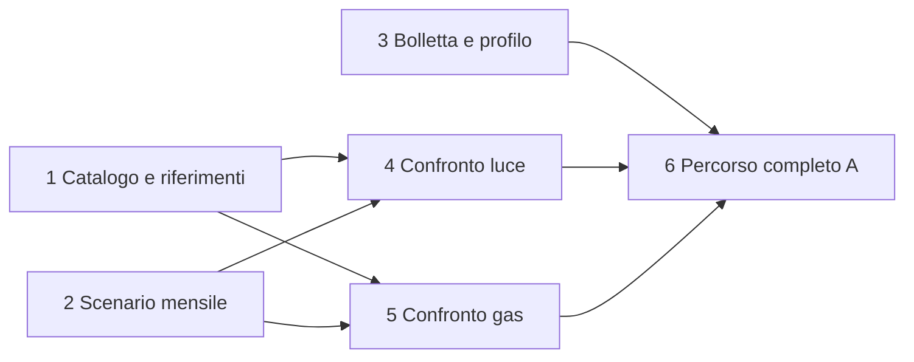

# Proposta di ticket per il primo percorso reale

Suddivisione e dipendenze approvate dall’utente il29ottobre2026; pubblicate con `to-tickets` come sotto-issue della [spec#6](https://github.com/TommyBez/la-mia-bolletta/issues/6); dipendenze native verificate. Specifica e contratti condivisi sono il riferimento comune prima dell'avvio. Preferenza rispettata: attività sostanziose con un esito dimostrabile, evitando ticket separati per ogni tabella, endpoint o componente. Le prime due attività sono percorsi operativi completi: comando→fonti→DB→lettura/stato, senza richiedere una dashboard amministrativa nuova.

| Ticket | Consegna verificabile | Bloccato da |
| --- | --- | --- |
| 1 | Acquisire/pubblicare/consultare catalogo quotidiano e riferimenti ufficiali luce/gas | Nessuno |
| 2 | Eseguire script mensile, validare/importare/leggere coefficienti dalDB | Nessuno |
| 3 | Bolletta o manuale→candidati→correzione→profilo confermato, archivio privato e costi misurati | Nessuno |
| 4 | Profilo manuale→confronto luce completo web/MCP, su dati pubblicati | 1,2 |
| 5 | Profilo manuale→confronto gas completo web/MCP, su dati pubblicati | 1,2 |
| 6 | Bolletta→consiglioA, attuale/risparmio, classifica/scheda/fornitore, due forniture e totale coerente | 3,4,5 |

Parallelismo:1/2/3 possono partire insieme;4/5 in parallelo quando1/2 sono completati;6 integra risultati già verificabili. Non aggiungere una dipendenza da3 a4/5: l'ingresso manuale e lo schema confermato concordato consentono di verificare il motore mentre l'OCR viene sviluppato. Nessuna dipendenza fittizia dai vecchi ticket sintetici#3–#5; riusarne l'UI se effettivamente disponibile.

I ticket4/5 possono implementare lo stesso modulo condiviso attraverso moduli commodity separati e contratti concordati. Schemi/migrazioni e adattatori comuni vanno concordati all'avvio per evitare file condivisi modificati contemporaneamente; non occorre introdurre un ticket di soli tipi o un'infrastruttura distribuita.

Ogni criterio di copertura nazionale si intende verificato su fonti/versioni/efficacia pertinenti; un riferimento non ancora materializzato o non riconciliato non è una copertura già acquisita. I dati ufficiali già scaricati, le qualifiche e i casi numerici vanno congelati in fixture e controllati nuovamente quando la fonte cambia.

## Collegamenti pubblicati e verificati

- 1. [Catalogo quotidiano e riferimenti ufficiali consultabili](https://github.com/TommyBez/la-mia-bolletta/issues/7) — bloccato da: nessuno.
- 2. [Coefficienti mensili: script manuale, importazione e lettura](https://github.com/TommyBez/la-mia-bolletta/issues/8) — bloccato da: nessuno.
- 3. [Bolletta o inserimento manuale → profilo confermato](https://github.com/TommyBez/la-mia-bolletta/issues/9) — bloccato da: nessuno.
- 4. [Profilo manuale → confronto luce reale via web e MCP](https://github.com/TommyBez/la-mia-bolletta/issues/10) — bloccato da: #7, #8.
- 5. [Profilo manuale → confronto gas reale via web e MCP](https://github.com/TommyBez/la-mia-bolletta/issues/11) — bloccato da: #7, #8.
- 6. [Consiglio A e percorso completo con bolletta, alternative e luce/gas](https://github.com/TommyBez/la-mia-bolletta/issues/12) — bloccato da: #9, #10, #11.
