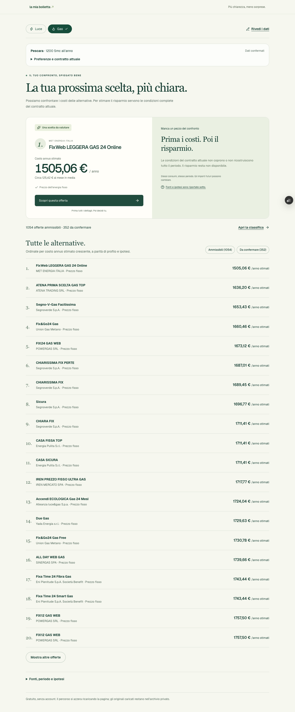
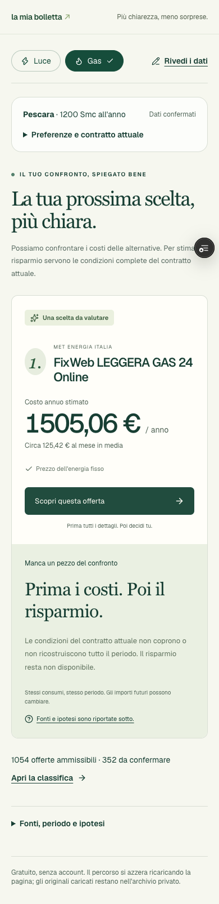

# Verifica del primo percorso reale — 30 ottobre 2026

Runtime verificato: commit `8d96baab836b9f61b9621f9aac421072c1c5bdec`, [preview interna protetta](https://la-mia-bolletta-8bumk8krn-tommasos-projects-bb9d6551.vercel.app/confronto), regione Francoforte. I commit successivi di questa consegna raccolgono prove, documentazione e correzioni al solo harness di verifica. Nessuna promozione in produzione.

## Esiti

| Percorso | Prova e risultato |
| --- | --- |
| Catalogo quotidiano | Due Workflow reali Vercel completati il 30 ottobre; replay `unchanged`, cataloghi `ready`, nessuna nuova pubblicazione artificiale. [Avvio](evidenze/percorso-reale-2026-10-30/workflow-start.json), [esito applicativo](evidenze/percorso-reale-2026-10-30/workflow-status.json). |
| Scenario mensile | Venti coefficienti PUN, quattro PSV, tredici formule annue Peak/OffPeak e sei CCR domestici qualificati, importati e riletti dal DB. Script mensili manuali; nessuna simulazione avviata dal confronto utente. |
| Confronto luce | 1.872 offerte attive esaminate sul profilo sintetico: 1.291 ammissibili, 368 da confermare, 213 non ammissibili. Prima e seconda offerta verificate sul Portale al centesimo. |
| Confronto gas | 1.529 offerte attive esaminate: 1.054 ammissibili, 352 da confermare, 123 non ammissibili. Prime due: 1.505,06 e 1.636,20 euro/anno, entrambe confermate indipendentemente sul Portale. |
| Web e MCP | Identiche tutte le proprietà salvo timestamp, con le stesse versioni: [luce](evidenze/percorso-reale-2026-10-30/parity-electricity.json), [gas](evidenze/percorso-reale-2026-10-30/parity-gas.json). Quattro tool in sola lettura, senza OCR MCP. |
| Browser distribuito | Sei test Playwright verdi: manuale→consiglio/classifica/scheda/reload; due forniture e consiglio di restare; telefono/tastiera/correzioni; contratto da archivio con soli identificativi; risposta reale ritardata; PDF sintetico→Blob privato→Gateway→candidati→conferma→consiglio reale. Nessuna navigazione ai siti dei fornitori. |
| Test e build | 156 test su PostgreSQL locale isolato, TypeScript e lint del percorso reale verdi. [CI Verify](https://github.com/TommyBez/la-mia-bolletta/actions/runs/40973368060) riuscita, build inclusa. Anche la build Vercel è riuscita. |

La fonte del catalogo resta datata **29 ottobre**: il replay non ne rinnova la freschezza. Copertura acquisita: 7.593 territori gas, 7.964 luce e 7.894 identità ISTAT riconciliate. Gli 11 supplementi di vendita gas sono vincolati a data e checksum dell'XML. Originali e manifesti sono nel Blob privato; i dati pubblici normalizzati e le prove sanificate sono versionati.

I due Workflow sono `wrun_41M64ZXNAS50YX6MXDKFG82X36` (luce, completato 23:29:16 UTC) e `wrun_41M64ZXNAS50YX6MXDKFG82X35` (gas, 23:29:18 UTC), entrambi sul deployment `dpl_FV11CS4dqGWZvv9KtKJVXnCwEtsQ`. Verificati anche tramite `workflow inspect run` sul backend Vercel, senza decifrare payload. Il cron automatico Vercel è configurato per la produzione; non viene presentato come cron attivo in preview.

## Correzioni dalla review

Regressioni al confine del servizio verificano scadenza del confronto alla scadenza delle offerte, preferenza fisso anche fra offerte condizionate, corrente incompleto senza costo zero/risparmio inventato e formula manuale `coefficiente × PUN con perdite + spread` con spread indipendente. Coefficiente zero gestito. Le condizioni dell'archivio vengono risolte dal server, senza accettare prezzi trasmessi dal client.

Le anomalie IVA del simulatore restano divergenze dichiarate: Senza Pensieri S e due scarti di 0,02 euro esattamente a 480 Smc per C1 B/F. Il motore mantiene la fiscalità normativa; [qualifica e prove](evidenze/ccr-gas-2026-10-30/README.md). Il ripiego GME non è qualificato per questa finestra e non viene attivato silenziosamente.

## Gate ancora aperto

**Quattro bollette reali ricevute e misurate il 30 ottobre.** Le prove hanno portato a correggere date italiane, uso combinato del gas, lettura dello storico e unità dei consumi incompleti. Il prompt v4 legge correttamente tutti i 37 valori annotati e rispetta 15 assenze; due percorsi con anno completo arrivano al confronto reale. [Resoconto, limiti e costi](evidenze/ocr-reale-2026-10-30/README.md). Sono quattro PDF nativi di due venditori, tutti variabili, usati anche per correggere il prompt: nessuna qualifica generale o holdout indipendente. #9 e #12 restano aperti per la copertura estesa descritta nella proposta operativa, **non per mancato invio dei file**. Originali ed estrazioni rimangono privati.

Il codice OCR aggiornato è `80223b285b20415c28ee6eb483b172cdec02a66e`, verificato nella [nuova preview protetta](https://la-mia-bolletta-f3r8w8n8k-tommasos-projects-bb9d6551.vercel.app/confronto). 157 test e CI verdi. Le quattro letture finali costano 0,076722 USD; tutta la sessione reale, incluse diagnosi e riprove, 0,27219225 USD comunicati dal Gateway.

Gli [aggregati degli smoke OCR](evidenze/percorso-reale-2026-10-30/ocr-usage.json) distinguono costi comunicati dal Gateway e costo ignoto del primo tentativo fallito prima della chiamata. Due letture sintetiche riuscite hanno registrato complessivamente 0,01398375 USD e 17.197 ms di esecuzione provider; non sono metriche di un corpus reale né il costo totale dell'infrastruttura.

Il lint completo dello starter include componenti UI preesistenti non formattati. `lint:real`, eseguito anche dalla CI, controlla tutti i moduli introdotti; le catture ufficiali restano escluse dalle trasformazioni di formato per conservarne i checksum.

## Interfaccia verificata

